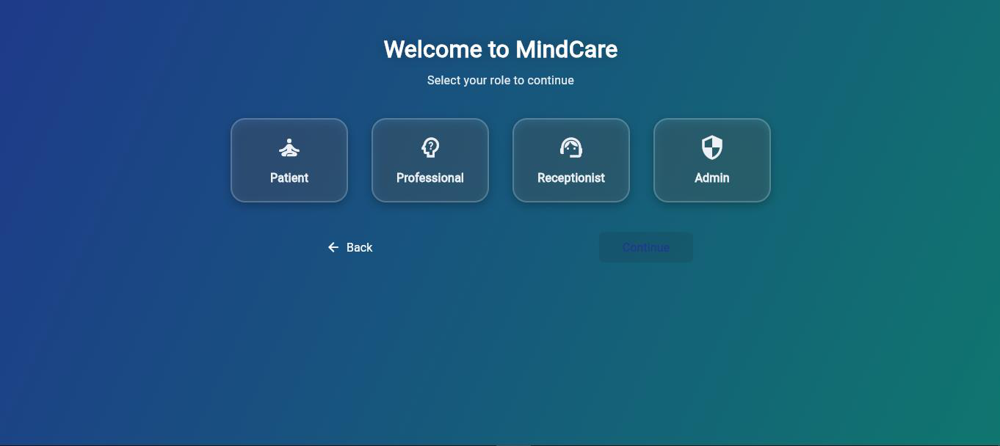

# 🧠 AI-Powered Mental Health Monitoring App
### Depression, Stress & Anxiety | Eswatini

A Flutter-based mobile app for early mental-health screening using questionnaire-based assessments, machine-learning-assisted analysis, personalized recommendations, and healthcare-provider workflows.

Built to improve access to mental-health support in underserved communities where stigma, distance, and shortages of professionals are real barriers.

> **Final-Year Project | BSc Computer Science**
> **Author:** Mancoba Maxwell Shabalala

---

## 🎯 What It Does

- Digital self-assessments for depression, stress & anxiety
- AI-assisted analysis + personalized recommendations
- Appointment booking & management
- Role-based access for the full clinic workflow

## ✨ Features by Role

**👤 Patient**
- Registration & login
- Mental-health self-assessments
- Assessment results + AI recommendations
- Appointment booking & consultation access
- Personal dashboard

**👨🏽‍⚕️ Healthcare Provider**
- Provider dashboard
- View patient assessment information
- Access AI-assisted recommendations
- Consultation workflow

**📅 Receptionist**
- View booked appointments
- Accept / manage appointments
- Set appointment reminders

**🛡️ Administrator**
- Manage user accounts
- Account & security management

## 🤖 AI & Machine Learning

ML Workflow:
`Dataset → Cleaning → Preprocessing → Feature Engineering → Training → Evaluation → Prediction → Recommendations`

Models support classification of mental-health assessment data and generate AI-assisted recommendations.

## 🛠️ Tech Stack

| Technology | Purpose |
| :--- | :--- |
| Flutter / Dart | Mobile app development |
| Firebase Auth | User authentication |
| Cloud Firestore | Cloud database |
| Python | Machine learning & data processing |
| Jupyter Notebook | ML experimentation & evaluation |
| Git / GitHub | Version control |

## 🏗️ System Architecture

Flutter Mobile App + Firebase Services + Python ML Components

## 📱 Screenshots

### Welcome & Authentication


### Patient Dashboard


### Mental Health Assessment


### Appointment Booking


## ⚙️ Installation

**Prerequisites:** Flutter SDK, Dart SDK, Android Studio, Firebase project

```bash
git clone YOUR_REPOSITORY_URL
cd YOUR_PROJECT_FOLDER
flutter pub get
flutter run
