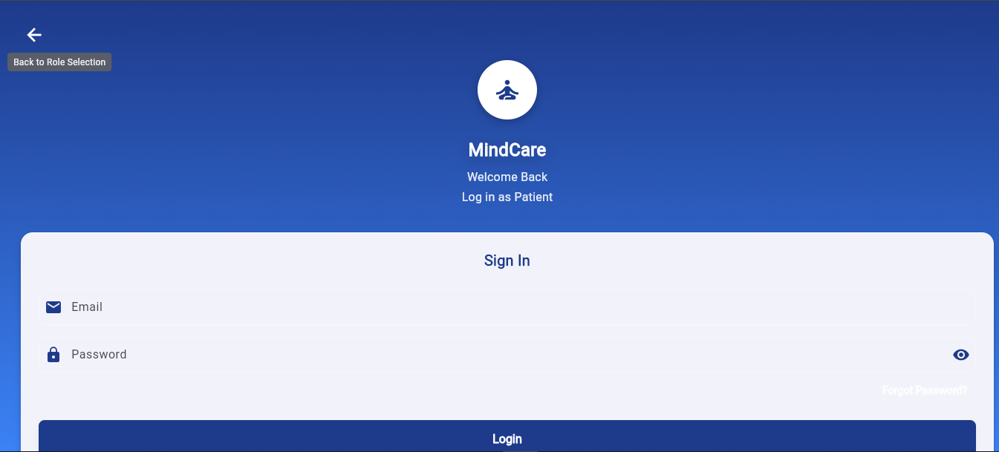
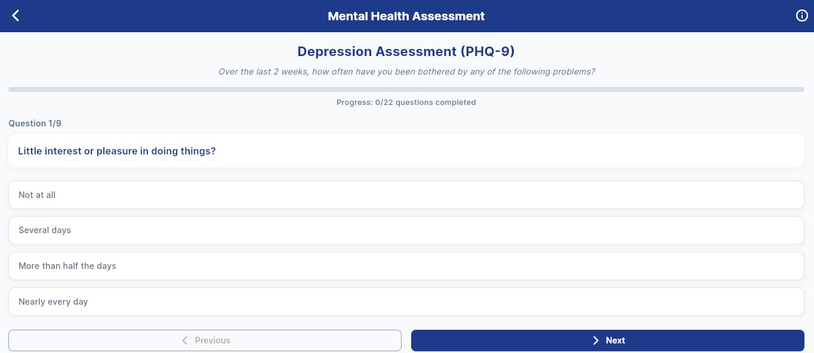
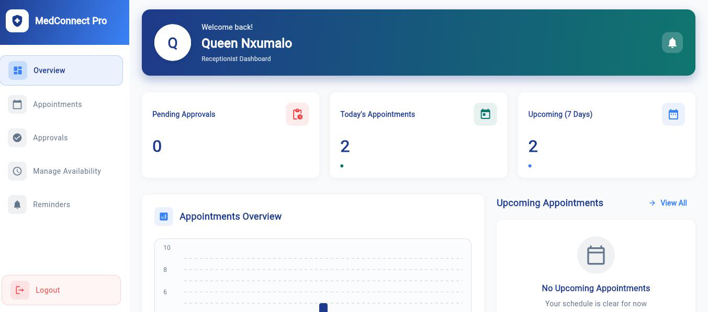
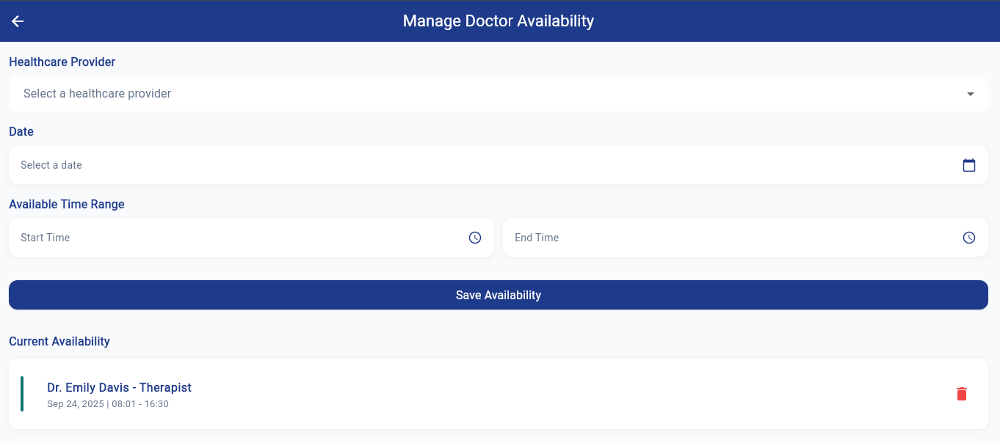
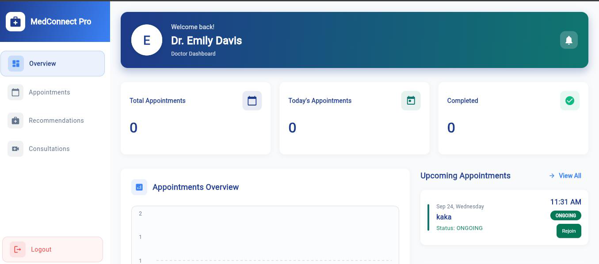
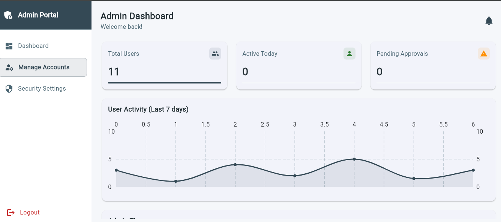
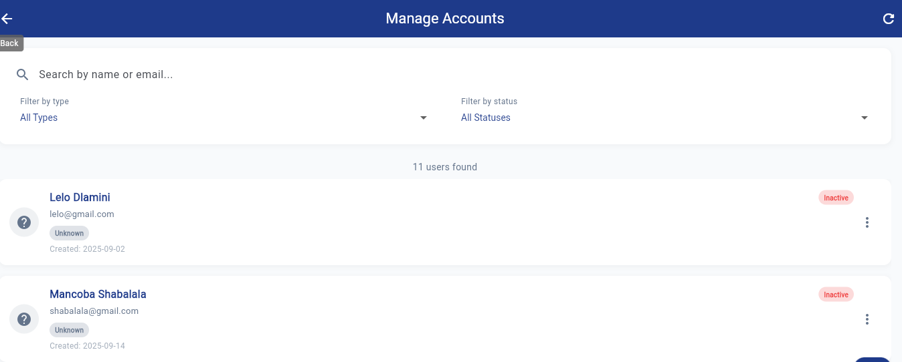

# 🧠 AI-Powered Mental Health Monitoring App
### Depression, Stress & Anxiety | Eswatini

A Flutter-based mobile app for early mental-health screening in Eswatini, using questionnaire-based assessments, machine-learning-assisted analysis, personalized recommendations, and healthcare-provider workflows.

Built to solve a real problem: stigma, long distances to clinics, and a severe shortage of mental-health professionals leaving many emaSwati undiagnosed and untreated.

**Final-Year Project | BSc Computer Science**
**Author:** Mancoba Maxwell Shabalala (202080165)
**University:** Eswatini Medical Christian University, Mbabane
**Supervisor:** Mr. F Mthethwa | **Presented:** 24 Sept 2025

---

## 🎯 Aim

To develop an AI-powered mental health monitoring app that assists individuals in managing depression, stress, and anxiety, while providing real-time recommendations to mental health professionals — private, stigma-free, and accessible.

---

## ✨ Features by Role

### 👤 Patient
- Register / Login, Personal dashboard
- Self-assessment for depression, stress & anxiety
- AI-assisted results + personalized recommendations
- Book appointment, Join live consultation

### 👨🏽‍⚕️ Healthcare Provider
- Provider dashboard, View patient assessments
- Access AI recommendations, Start live consultation

### 📅 Receptionist
- View appointments, Accept / manage appointments
- Set appointment reminders

### 🛡️ Admin
- Dashboard with system analytics, user logs, security alerts
- Manage user accounts & access

---

## 🏗️ System Architecture

- **Frontend:** Flutter (Dart) — cross-platform Android & iOS
- **Application Layer:** Business logic, auth, session management
- **Backend / AI:** Python in Jupyter Notebook, FastAPI, TensorFlow Serving
- **Database:** Firebase Firestore (real-time sync) + AWS S3 (secure logs/reports)
- **Security:** Firebase Auth, OAuth 2.0, JWT, Role-Based Access Control (RBAC), encryption, GDPR/HIPAA-aware design

**AI Workflow:** Kaggle Dataset → Cleaning → Preprocessing → Feature Engineering → Training → Evaluation → Prediction → Recommendations

---

## 🛠️ Tech Stack

| Technology | Purpose |
| --- | --- |
| Flutter / Dart | Mobile app |
| Python / Jupyter | ML training & data processing |
| FastAPI / TensorFlow Serving | AI model deployment & real-time inference |
| Firebase Auth / Firestore | Auth + real-time database |
| AWS S3 | Secure storage for logs/reports |
| Postman / JUnit / Mockito / Firebase Test Lab | API & app testing |
| Git / GitHub | Version control + CI/CD |
| Android Studio / VS Code | Development |

---

## 📱 Screenshots

| Welcome | Login | Assessment |
| --- | --- | --- |
|  |  |  |

| Appointment | Receptionist | Provider |
| --- | --- | --- |
|  |  |  |

| Admin | Admin - Manage Accounts |
| --- | --- |
|  |  |

---

## ⚙️ Installation

**Prerequisites:** Flutter SDK, Dart SDK, Android Studio, Firebase project

```bash
git clone https://github.com/Max13570/ai-mental-health-monitoring.git
cd ai-mental-health-monitoring
flutter pub get
flutter run
